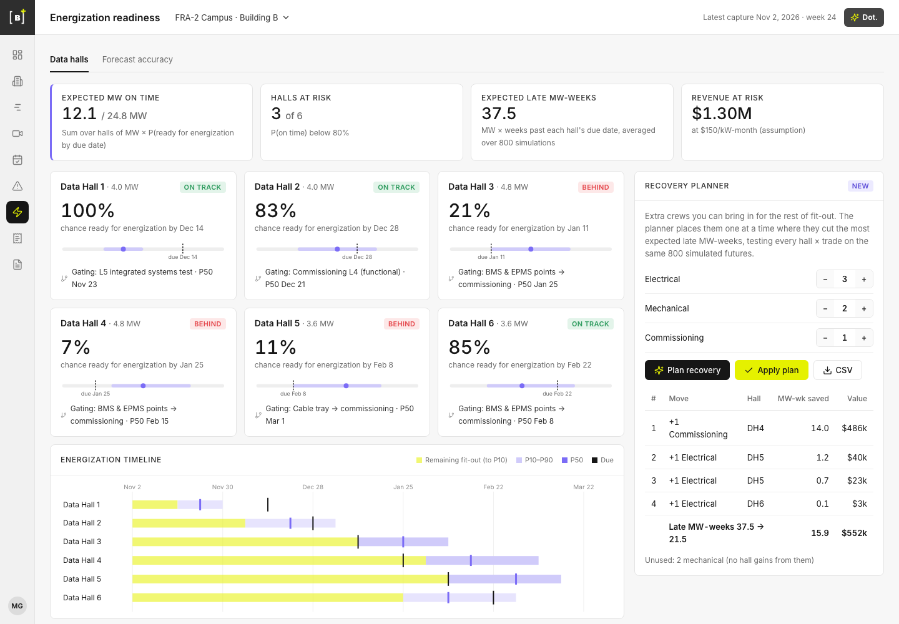

# Energization Readiness for Buildots

**Live demo:** https://mohith26.github.io/buildots-energization-readiness/

Buildots is now on multi-gigawatt data-center programs (Green Mountain, Digital Realty), where the date that matters is not when an activity finishes but when each data hall is ready for energization and can start earning revenue. Energization Readiness is a concept for a Buildots view that turns the weekly capture data the platform already produces into a **calibrated probability that each hall is ready by its due date**, and a **recovery planner** that says where a limited pool of extra crews buys back the most late megawatt-weeks. In a 200-project backtest its on-time probabilities scored a Brier of 0.098 versus 0.293 for extrapolating recent pace (halls it gave 80-100% finished on time 96.5% of the time), and its plans cut expected late MW-weeks by 27% versus 23% for "send crews to the most-behind hall".



## What it does

* **Data halls** (`#/readiness`): one card per hall with P(ready for energization by due date), the P10-P90 window, the gating activity and P50 date; KPIs for expected MW on time, halls at risk, expected late MW-weeks and revenue at risk (at an assumed $150/kW-month); an energization timeline.
* **Hall drawer** (`?hall=DH3&act=TRY`): Delay-Forecast-style pace cards (average, recent, required, forecast pace with weeks of delay at each), an over-time chart with actual, schedule, forecast P50 and P10-P90 band and the delay region, and every activity's progress, crews and P50 finish.
* **Recovery planner**: set extra crews by trade, "Plan recovery" places them one at a time where they save the most expected late MW-weeks (value in $), "Apply plan" re-forecasts with the crews added (persisted in `localStorage`), CSV export.
* **Forecast accuracy** (`#/backtest`): reliability diagram and table, Brier comparison, recovery-plan comparison.

Keyboard: `1`-`6` open a hall, `P` plan, `A` apply, `B` accuracy, `Esc` close, `?` help.

## How it works

1. **Activity network per hall.** Floor → containment / piping / fire suppression → busway, cable tray, CRAH → PDUs, BMS → commissioning L3 → L4 → L5 IST. Topologically ordered; finish-to-start.
2. **Pace posteriors from captures.** Each weekly capture gives units installed and effective crew-weeks. Log output per effective crew-week gets a conjugate normal model, partially pooled across halls (an activity a hall has not started borrows the other halls' pace; if no hall has started it, the planned pace with wide uncertainty).
3. **Crew stacking.** n crews of a trade in one hall deliver n^0.85 crew-weeks (diminishing returns), and a trade's crews work its available activities in network order.
4. **Monte Carlo.** 800 simulated futures per hall: draw each activity's pace from the posterior (epistemic) plus week-to-week noise, run the network forward, record the ready-for-energization week. P(on time), quantiles and expected late MW-weeks come from these draws.
5. **Greedy recovery planner.** Repeatedly add one crew to the hall × trade with the largest drop in expected late MW-weeks, evaluating every candidate on the same random futures (common random numbers) so differences are signal, not noise; stop when no move helps or the pool is empty.

Logic is in `src/core.js` (pure functions). The page computes everything from `data/project.json` at load.

## Results (data/results.json, 200 simulated projects, 1,200 halls)

| Metric | Energization Readiness | Baseline |
|---|---:|---:|
| Brier score of P(on time) | **0.098** | 0.293 (recent-pace extrapolation, 0/1; right 71% of the time) |
| Reliability, 80-100% bin (202 halls) | predicted 94.5%, realized **96.5%** | n/a |
| Reliability, 60-80% / 40-60% bins | 69.5% vs 72.0% / 48.4% vs 47.9% | n/a |
| Reliability, 20-40% bin (132 halls) | predicted 28.4%, realized 48.5% (under-confident) | n/a |
| Reliability, 0-20% bin (679 halls) | predicted 4.3%, realized 5.6% | n/a |
| Late MW-weeks per project with +3 electrical, +2 mechanical, +1 commissioning | **66.9** (−27%) | 70.8 (−23%) most-behind-first; 91.7 with no extra crews |

Plans are chosen with the model's posterior but judged under each project's hidden true paces.

## Data

Synthetic and seeded (`node data/generate.mjs`): a fictional six-hall, 24.8 MW building ("FRA-2 Campus, Building B"), illustrative quantities and crew rates for data-hall fit-out, hidden true paces that differ by project, hall and activity, and weekly capture observations generated from the true process. Planned paces are seeded from Buildots' published [Data Center MEP Benchmarks](https://buildots.com/lab/data-center-mep-benchmarks) (HVAC achieves 76.9% of required pace, electrical containment 59.4%; plan-vs-actual gap 20-50%; peak weeks 3-5x average, which sets the week-to-week variability); activities without a published figure use 75%. Unstarted activities' priors use the benchmark-corrected planned pace. Revenue uses an assumed $150/kW-month; change it in `data/project.json`.

## Honest limitations

* Real fit-out is not strictly finish-to-start, crews move between halls week to week, and commissioning depends on utility power and equipment deliveries that are not modeled.
* Stacking exponent (0.85) and the commissioning buffer (3 weeks for the required-pace card) are assumptions, not fitted.
* The greedy planner is not guaranteed optimal; expected lateness is not exactly submodular in crews. It is a good, explainable heuristic, and the backtest shows it beats the natural rule.
* Calibration is shown on simulated projects whose generating process matches the model family, and it is not perfect even there: the 20-40% bin is under-confident (predicted 28%, realized 49%), likely from the wide benchmark prior on unstarted activities. Real projects will be messier; the first real check would be the same reliability table on Buildots' historical projects.
* Cross-trade congestion is not modeled (only same-trade stacking). Buildots' own schedule-intelligence write-up describes adding fire-suppression crews making things worse by constraining other trades; a production version should learn that interaction from capture data.

## Prior art and what is new

Buildots already forecasts delays per activity from recent, average and required pace, lets teams "model different recovery strategies using actual, required, and planned pace", and Dot can investigate a forecasted delay or suggest where a trade should focus. Buildots' schedule-intelligence work validates baseline schedules against production benchmarks before construction, and its webinar with Microsoft describes Monte Carlo simulation as a pre-construction practice. Schedule risk analysis (Monte Carlo on CPM networks) is also standard in tools like Primavera Risk Analysis and Safran Risk, but it runs on planner-entered duration ranges, not on pace measured every week during fit-out. What is new here: probabilities driven by captured pace with partial pooling across halls, rolled up to the business outcome data-center owners care about (MW ready for energization by date), validated for calibration, and a prescriptive planner that ranks crew moves by MW-weeks saved.

## Run it

```bash
node data/generate.mjs      # regenerate data/project.json and data/results.json (~20 s)
node --test test/*.test.mjs # 15 tests, including the headline numbers
python3 -m http.server      # then open http://localhost:8000
```

CI runs the tests on every push (`.github/workflows/test.yml`).

---
Unofficial concept demo by Mohith Gajjela. Not affiliated with Buildots. Synthetic data.
